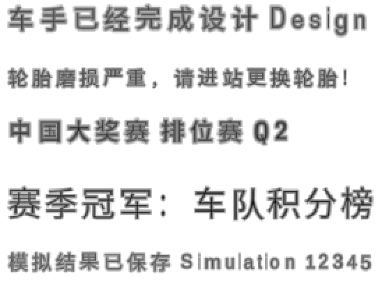

# Motorsport Manager 简体中文汉化

[](LICENSE)
[](https://store.steampowered.com/app/415200/)
[](../../releases)

把《Motorsport Manager》的界面、邮件、新闻、采访、教程、推特、赛事解说等**全部文本**替换为简体中文，
并重建了游戏内的 TextMesh Pro 位图字体，让中文能正常显示。

补丁本体是一个 `resources.assets` 文件，直接覆盖即可，**不需要改任何语言设置**。

📦 **[下载补丁](../../releases)** ｜ 📖 [安装说明](installer/说明.md) ｜ 🔧 [技术说明](docs/技术说明.md) ｜ ✍️ [贡献指南](docs/贡献指南.md)



*上图不是设计稿。`tools/preview.py` 复刻了 TextMesh Pro 的排版算法（四边形摆放、UV 计算、
距离场解码），从补丁后的字体资产里真实渲染出这张图，所以它就是游戏里画出来的样子。*

---

## 一、安装

**从 [Releases](../../releases) 下载 `MM-Chinese-Patch-v1.0.zip`。**

1. 关闭游戏。
2. 把压缩包解压到游戏的安装目录里（和 `MM.exe` 同级）：

   ```
   ...\Steam\steamapps\common\Motorsport Manager\
       ├─ MM.exe
       ├─ MM_Data\
       └─ 简体中文汉化\              ← 解压到这里
            ├─ 安装汉化.bat
            ├─ 卸载还原.bat
            ├─ resources.assets
            └─ 说明.md
   ```

   > 放别的地方也行。脚本会依次检查：补丁文件夹附近 → Steam 注册表里的安装路径 →
   > Steam 默认安装位置，都找不到时会提示你手动输入游戏目录。

3. 双击 `简体中文汉化\安装汉化.bat`。

脚本会把原文件备份成 `MM_Data\resources.assets.orig`，然后装上汉化。

**卸载**：双击 `卸载还原.bat`；或者用 Steam 的「验证游戏文件完整性」，
之后重新跑一次安装脚本即可。

> **为什么不用改语言设置？**
> 游戏的界面语言跟着 **Steam 客户端语言**走，设置界面里的语言下拉框其实是空实现
> （`GamePreferences.SetLanguage` 方法体是空的）。所以补丁把游戏读取的**全部 10 个语言列**
> 都写成了简体中文，无论 Steam 是中文、英文还是其他语言，界面都会是中文。
> 细节见 [技术说明](docs/技术说明.md#语言是怎么选的)。

---

## 二、汉化范围

| 内容 | 行数 |
| --- | ---: |
| 界面 / HUD / 菜单（Frontend） | 5,355 |
| 媒体新闻（MediaReports） | 1,858 |
| 比赛事件与解说（RaceEvent） | 1,342 |
| 比赛阶段台词（PreRaceTalk） | 999 |
| 车队电台字幕（TeamRadio） | 962 |
| 邮件与消息（Messages） | 955 |
| 教程（Tutorials） | 948 |
| 国籍 / 人名（Nationalities） | 820 |
| 采访（Interviews） | 689 |
| 社交媒体（Tweets） | 515 |
| 通用词条（Shared） | 422 |
| 模拟与规则说明（Simulation） | 329 |
| 两难事件（Dilemmas） | 242 |
| 挑战模式（Challenges） | 170 |
| **合计** | **12,944 行 / 11,605 条独立文本** |

覆盖率 **100%**，没有任何一条回退成英文。唯一保留拉丁字母的 61 条是按键名、
F1–F12、`DD/MM/YYYY` 这类格式串和赛事缩写，白名单在
[`tools/glossary.py`](tools/glossary.py) 的 `KEEP_LATIN` 里。

### 术语校正

通用翻译引擎在没有上下文时会把短标签翻得很离谱，所以另做了一层赛车术语表
（607 条整句覆盖 + 38 条短语修正）：

| 英文 | 直译（错误） | 本汉化 | | 英文 | 直译（错误） | 本汉化 |
| --- | --- | --- | --- | --- | --- | --- |
| Drivers | 司机 / 驱动程序 | 车手 | | Session | 会话 | 阶段 |
| Race | 种族 | 比赛 | | Grid | 网格 | 发车区 |
| Team | 团队 / 球队 | 车队 | | Podium | 讲台 | 领奖台 |
| Suspension | 悬浮液 | 悬挂 | | Mechanic | 机制 | 技师 |
| Save / Load | 拯救 / 负载 | 保存 / 载入 | | Scouting | 侦察 / 童军 | 招募 |
| Car | 汽车 | 赛车 | | Sponsors | 提案国 | 赞助商 |

完整对照见 [术语表](docs/术语表.md)。

### 字体

游戏 UI 用的是 TextMesh Pro 的**位图 SDF 字体**，图集里只有拉丁字母，
直接塞中文会显示成一堆空白方块。补丁：

1. 把 11 个 UI 字体图集从 1024² / 2048² 扩到 **4096²**，
   原图集内容**像素级保留**，空出来的地方用 **Noto Sans SC** 生成了
   2,424 个中文（含全角标点）字形的距离场数据；
2. 同步重写字形表的位置、尺寸、基线偏移和步进宽度。

用到的字重有 Medium / Bold / Regular / Light / Thin，对应游戏里不同的字体槽位。
五个度量与游戏自带拉丁字形的**平均误差 0.15 像素**。

---

## 三、技术要点

这个补丁不是「把 CSV 翻译一遍」那么简单。挑几个值得记录的：

**机器翻译会吃掉游戏标记。** 实测 `[[V0]]` 形式的占位符会被引擎直接删掉，
或者改写成 `[2019-01-15]` 这样的日期；`%{2}`、`${1}`、`300{1}` 会被当成
货币/千分位/printf 格式吃掉左花括号。最终方案是所有标记统一用 `{n}`，
并把紧贴占位符的无字母串（如 `+30%`）一起并进占位符。

**占位符太多会直接拒翻。** 引擎对占位符密度过高的输入会原样回显，
而这种结果占位符是完整的、查不出来，必须单独识别。对策是合并连续标记 +
三轮降级重译（整句 → 按行 → 按片段），第一轮即通过 98.6%。

**字体必须自己造。** 图集里没有汉字，也没有现成的中文字体可以替换 ——
游戏的字体是烘进图集的距离场，得反推它的编码
（`alpha = 0.5 + distance_px / (2 × (padding + 1))`）再逐字重算。
中文字形的五个度量全部由同一次 FreeType 光栅化推导，图集内容与字形表因此不可能对不上。

**装过补丁之后不能再拿游戏目录当输入。** 打了补丁的 `resources.assets` 是 373 MiB，
再拿它当源会把中文当成英文原文、把图集重复缩比。`mmcore.pristine_assets()`
专门挡这种情况。

完整的技术细节、实测数据表、以及踩过的坑都在 **[docs/技术说明.md](docs/技术说明.md)**。

---

## 四、仓库结构

```
mm-cn/
├─ tools/                     汉化流水线
│   ├─ mmcore.py              路径、常量、原版文件判定、控制台编码
│   ├─ extract.py             从 resources.assets 导出 CSV / 图集 / 内嵌字体
│   ├─ run_translate.py       翻译驱动（收集 + 调度）
│   ├─ translate.py           翻译引擎封装：分批、缓存、校验、三轮降级
│   ├─ markup.py              标记保护（<标签>、{变量}、换行 → {n}）
│   ├─ glossary.py            赛车术语表 + 保留拉丁串白名单
│   ├─ unitybin.py            Unity 二进制读写小工具
│   ├─ tmpfont.py             TextMesh Pro 1.0 字体资产格式
│   ├─ sdf.py                 SDF 字形生成
│   ├─ cjkfont.py             图集扩充与字形打包
│   ├─ build_patch.py         生成 dist/resources.assets
│   ├─ verify.py              结构校验（读构建产物）
│   ├─ accept.py              终验收 42 项（读已安装到游戏的文件）
│   ├─ preview.py             按 TMP 排版算法渲染预览图
│   └─ scan_assets.py         研究用：把 MonoBehaviour 映射回脚本类名
├─ docs/
│   ├─ 技术说明.md            逆向细节、实测数据、踩过的坑
│   ├─ 术语表.md              术语对照与保留串清单
│   ├─ 贡献指南.md            怎么改进翻译
│   └─ 字体效果预览.png
├─ installer/                 随 release 发布的安装脚本与玩家说明
├─ scripts/
│   ├─ make_installer.py      生成 installer/*.bat（GBK 编码）
│   └─ package_release.py     打包 release zip
├─ trans/
│   └─ zh_cache.jsonl         翻译记忆（11,605 条），这是补丁的核心产物
├─ extract/   *               游戏原始 CSV（本地生成，不入库）
├─ assets/    *               游戏原始图集 / TTF（本地生成，不入库）
├─ build/     *               中间产物
└─ dist/      *               补丁成品与 release 包
```

`*` 目录里是游戏自己的资源。仓库**不含**它们，全部由 `tools/extract.py`
从本地游戏重新生成。

---

## 五、从源码构建

需要 Python 3.10+ 和一份正版游戏（用于导出原始资源）。

```bash
pip install -r requirements.txt

# 指向你的游戏目录（默认是 D:\SteamLibrary\...）
set MM_GAME=D:\SteamLibrary\steamapps\common\Motorsport Manager

# 1. 导出游戏原始数据（优先读安装脚本留下的 resources.assets.orig）
python tools/extract.py

# 2. 翻译（可断点续传；trans/zh_cache.jsonl 已入库时这一步几乎是空转）
python tools/run_translate.py

# 3. 生成补丁
python tools/build_patch.py              # 完整构建：文本 + 字体，约 6 分钟
python tools/build_patch.py --text-only  # 只重写文本，约 30 秒

# 4. 校验
python tools/verify.py     # 结构校验，读 dist/resources.assets
python tools/accept.py     # 终验收 42 项，读已安装到游戏里的文件
python tools/preview.py    # 生成字体预览图

# 5. 打包
python scripts/make_installer.py
python scripts/package_release.py
```

产出：

```
dist/resources.assets            373 MiB（原文件 214 MiB）
dist/MM-Chinese-Patch-v1.0.zip   release 包
dist/补丁信息.json               版本、MD5、覆盖率等发布信息
```

---

## 六、已知限制

- **真人语音没有替换。** 游戏里只有 19 段 `MM_RadioMessage_*` 语音音效，
  无法可靠地对应到具体台词，也没有合适的中文 TTS 音源；
  所有语音对应的**字幕文本**已经汉化。
- **玩家输入的名字、车队名保持原样。** 游戏自带的输入框不能输入中文
  （Unity 5.3 的 IME 限制），这是引擎层面的问题，与本补丁无关。
- 程序化拼接的新闻、推特长句由机器翻译生成，个别句子读起来略生硬。
- 111 条（约 0.9%）句子里的变量在中文里的位置与英文不同，这是按中文语序调整的结果，
  不影响功能。

---

## 七、免责声明

本补丁只修改文本与字体资源，**不修改任何可执行文件**，也不绕过任何校验。
请自行备份原文件；因使用本补丁导致的存档异常、游戏崩溃等问题，作者不承担责任。

《Motorsport Manager》版权归 Playsport Games / SEGA 所有。
仓库里不包含游戏的任何原始资源文件；`trans/zh_cache.jsonl` 只保存
「英文原文 → 中文译文」的对照，用于让翻译可审阅、可复现。

## License

代码部分以 [MIT](LICENSE) 发布。字体里的中文字形来自
[Noto Sans SC](https://fonts.google.com/noto/specimen/Noto+Sans+SC)（SIL Open Font License 1.1）。
